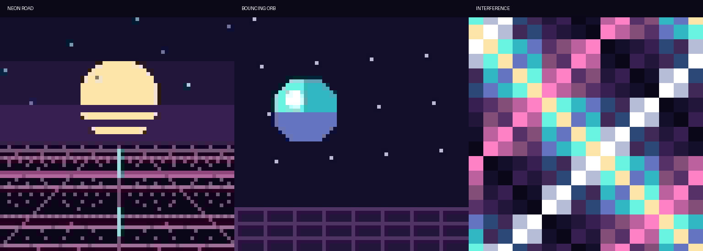
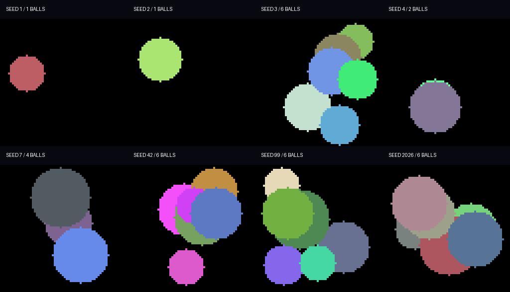
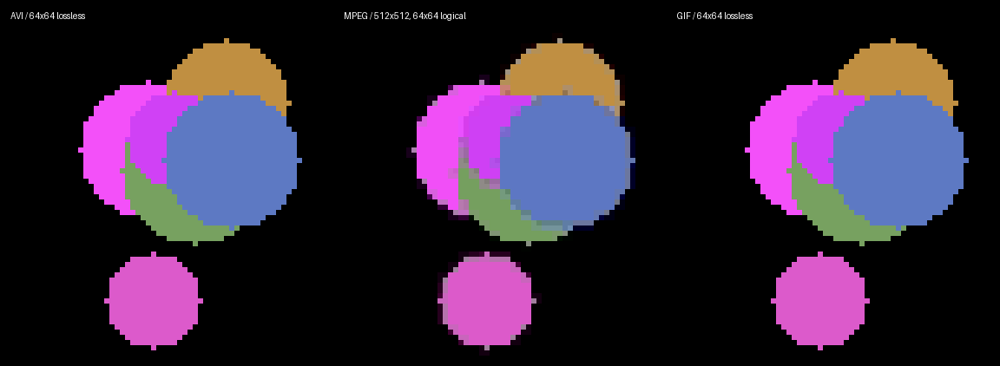
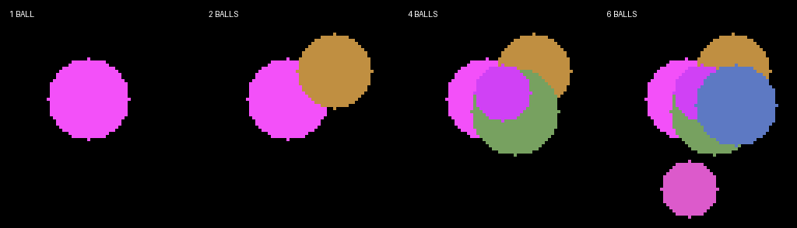

# Solidity video experiment

Source and ongoing development: [ColinPlatt/sol_vid](https://github.com/ColinPlatt/sol_vid).

New development: [**blocks — Neo-Tokyo block art**](docs/BLOCK_ART.md), a separate
collection derived from ten verified Base blocks per token. Eight 128px scenes,
six-second loops, native GIF and AVI, with a separate disabled `/blocks/` mint page.
[Preview sheet](previews/blockart/contact-sheet.png) · [local gallery](previews/blockart/index.html).
This collection is not deployed; the live ghoulballs collection below is unchanged.


| Contract | Purpose |
|---|---|
| `SolVideo` | Complete uncompressed indexed AVI and animated GIF files |
| `MpegVideo` | MPEG-1 elementary streams and timestamped `.mpg` files |
| `GenerativeVideo` | All encoders together, with seed-only entry points and inspectable traits |
| `AviRleVideo` | Lossless 256/512px BI_RLE8 AVI and static SVG poster |
| `AviRlePlayer` | Self-contained onchain HTML player for an immutable RLE renderer |
| `GenerativeTraits` | Shared deterministic seed recipe and public traits |
| `Scene` | Shared procedural drawing and palette generation |
| `SolVideoNFT` | Free, 6,667-token `ghoulballs` ERC-721 whose artwork is an onchain animated GIF |

**Yes: a single Solidity static call can generate a complete MPEG-1 video under 500 million gas.** This project includes working MPEG-1, AVI, and separate animated GIF experiments, with the returned files in `previews/`.

The main example is [a two-second MPEG video](previews/mpg-512-25-0.mpg): 512×512, 25fps, 50 independently encoded frames, **357,602,125 gas**, 267,000 bytes. A [browser-friendly MP4 viewing copy](previews/mpg-512-25-0.preview.mp4) is available. **Only the MP4 viewing copies are encoded offchain**; `.mpg`, `.m1v`, `.avi` and `.gif` are the exact bytes returned by the contracts.



## ghoulballs NFT — live on Base

**Mint: [ghoulballs.vercel.app](https://ghoulballs.vercel.app)** ·
[collection on Basescan](https://basescan.org/address/0xf3654d0ce6cf518f4efbbe490f4a26483fb0969c#code) (verified) ·
[Base deployment](docs/BASE.md) · [manifest](deployments/base.json).

The ERC-721 collection name and symbol are both **`ghoulballs`**. Anyone can call
`mint()` or `mintTo(recipient)` once per address, for no protocol payment, up to a
fixed maximum of **6,667 tokens**. There is no owner, pause or upgrade function.
The one-mint limit is keyed to the caller, so it stops repeat mints from one wallet,
not one person using many wallets. Each mint gets the next token ID and a deterministic
seed derived from the collection address, chain ID and token ID (`SOL_VIDEO_NFT_V1`).
Minting does not run the encoder. Deployment scripts mint token 1 to the deployer.

The artwork is the GIF. `tokenURI(id)` returns onchain JSON whose `image` is the
64×64, 20-frame animated GIF wrapped in a small SVG at 1024×1024 with
`image-rendering: pixelated`, so upscaled previews keep hard pixels. There is no
`animation_url`: marketplaces did not run the HTML players needed for the AVI and
MPEG-1 versions, so that work is parked on the `avi-mpeg-players` branch. `gif(id)`,
`imageURI(id)`, `seedOf(id)` and `recipeOf(id)` are available too.

A full `tokenURI` read, measured as a real capped call including the base64 layers
and ABI return copy, takes **33.9M gas** for the first exported token and **49.6M**
for the six-ball stress token (six-ball samples for each motion peak at 49.8M).
URIs are about 100KB. That is roughly a tenth of the MPEG version and within, but
close to, the common 50M `eth_call` cap; large six-ball tokens may still need a
higher-cap RPC.

Local test token: [GIF](previews/nft/token-1.gif),
[decoded metadata](previews/nft/token-1.metadata.json).
These are local test artifacts, not live Sepolia tokens.

**Deployed on Sepolia (Glamsterdam).**
[Collection v4 `0x02f3825aaf1d07efbdee52b5308981ecf47d769d`](https://sepolia.etherscan.io/address/0x02f3825aaf1d07efbdee52b5308981ecf47d769d) (current: GIF-only, V3 colours, one mint per address) with [renderer v2 `0xbd0e5fbcffd843f8c58a7bbb3cb6f75400fd60f9`](https://sepolia.etherscan.io/address/0xbd0e5fbcffd843f8c58a7bbb3cb6f75400fd60f9) (`GHOULBALLS_VAPOR_V3`) ·
[Collection v3 `0x48cd7822a357b473bab2b0bc90a0926c1e1897ab`](https://sepolia.etherscan.io/address/0x48cd7822a357b473bab2b0bc90a0926c1e1897ab) (GIF/AVI/MPEG sets with onchain players, from the `avi-mpeg-players` branch) ·
[Collection v2 `0xe7b06a27957ad992db764939c1836f92386369f1`](https://sepolia.etherscan.io/address/0xe7b06a27957ad992db764939c1836f92386369f1) (superseded, pixelated SVG image) ·
[Collection v1 `0xd162eacfb30b69523aebc9dc0a07c28b7e26f11a`](https://sepolia.etherscan.io/address/0xd162eacfb30b69523aebc9dc0a07c28b7e26f11a) (superseded plain-GIF image; still live, being immutable) ·
[V2 renderer for v1–v3 `0x3845c8f4ae6cbdb26988b78d8f7169cfd2d94b8a`](https://sepolia.etherscan.io/address/0x3845c8f4ae6cbdb26988b78d8f7169cfd2d94b8a).
Both transaction receipts succeeded and the live bytecode matches the tested build.
Etherscan source verification is currently blocked because its verifier rejects
the Amsterdam EVM target; see the deployment runbook for the exact status.
v2 reuses the unchanged v1 renderer (bytecode re-checked) and was deployed with
`script/DeploySepoliaCollection.s.sol` (14,620,477 gas). Seeds include the
collection address, so v2 tokens differ from v1 tokens with the same ID.
The free v2 mint was checked with live gas estimation (352,371 gas).

The default toolchain is Foundry 1.8.5+, Solidity 0.8.37 and the `amsterdam`
execution target. Base remains on separate Cancun profiles. Sepolia deployments
used **38,107,531 gas** across the two successful transactions; the earlier
Cancun-estimated failed attempt is recorded separately in the manifest.
OpenZeppelin v5.4.0 dependencies are pinned and vendored.

See the [Sepolia deployment runbook](docs/SEPOLIA.md) for dry-run, signer,
broadcast, source verification and post-deployment steps. The public deployment
manifest is [deployments/sepolia.json](deployments/sepolia.json).

## Mint page

**[ghoulballs.vercel.app](https://ghoulballs.vercel.app)** (source: [mint-page/](mint-page/README.md)).
Base only: wallet connection that brings the wallet to Base, a free mint (one per
address), a share pop-up after minting, and every minted token read straight from
the chain. Each token has its own page, `/t/<id>`, with a preview card
(`/t/<id>.png`) and the raw GIF (`/t/<id>.gif`). Sepolia collections stay in
[deployments/sepolia.json](deployments/sepolia.json) but are not shown.

## Generative vaporwave from one seed

The current artwork combines shaded neon balls with the original vaporwave look:
striped sunsets, sparse stars, mountain silhouettes and a scrolling perspective
grid. Each seed chooses **1, 2, 4 or 6 balls**, a palette, ball colours and radii,
and one of four seamless two-second motion styles.

| Motion | Behavior |
| --- | --- |
| Ricochet | Independent reflected paths across the canvas |
| Orbit | Smooth elliptical paths with individual starting phases |
| Float | Horizontal bouncing with gentle vertical bobbing |
| Figure Eight | Interwoven paths with two vertical cycles per loop |

The four palettes are Midnight, Lagoon, Ultraviolet and Sunset. All formats share
the same scene and motion; GIF/AVI are lossless, while MPEG retains its block and
chroma approximations. Curved paths use a deterministic integer parabolic sine
approximation. They need no floating point, external assets or stored frames.



[Watch the animated gallery](previews/generative/seed-gallery.preview.gif).
This gallery is an offchain montage of exact Solidity-generated GIFs, rather
than a contract return value. Each individual seed GIF, AVI or MPEG is generated
by one capped static call.

```solidity
GenerativeVideo art = new GenerativeVideo();
bytes memory gif = art.gifFromSeed(64, 25, 6);
bytes memory avi = art.aviFromSeed(64, 25, 6);
bytes memory mpg = art.mpgFromSeed(512, 6);
GenerativeVideo.Recipe memory traits = art.recipe(6);
```

The art recipe is explicitly versioned **`GHOULBALLS_VAPOR_V3`**. Its hash selects
ball count from the low two bits; later bits select theme and motion.
Per-ball hashes select radii (5–10 logical pixels), starting phases and each ball's
own colour: integer HSV with any hue (0–359°), saturation 120–229 and value 220–255.
(V2 rotated one fixed six-colour neon list, so only six ball colours existed;
Sepolia collections v1–v3 use the V2 renderer.)
`recipe(seed)` exposes theme/motion indices, palette and ball traits;
`themeName` and `motionName` resolve the names. NFT metadata includes the art
version, theme and motion. NFT seeds use `SOL_VIDEO_NFT_V1` per token.
The original scenes remain available.

Scenes **7–10** are the new 1/2/4/6-ball compositions. The original scenes 0–6
remain available explicitly, including the plain ball experiments below. Existing
V1 seed exports are retained as historical examples; the gallery and NFT now use V2.
The backdrop is generated once and reused within each single video call.

| Six-ball Figure Eight, seed 6 | Gas | File bytes |
| --- | ---: | ---: |
| [AVI](previews/avi-64-25-10-seed6.avi) | 36,033,158 | 206,296 |
| [GIF](previews/gif-64-25-10-seed6.gif) | 83,081,561 | 138,831 |
| [MPEG](previews/mpg-512-25-10-seed6.mpg) | 296,544,367 | 277,899 |

Nine exported seeds (1, 2, 3, 4, 6, 7, 42, 99 and 2026) cover every motion and ball
count. Exact gallery traits are in [recipes.json](previews/generative/recipes.json).
Tests check reproducibility, recipe bounds, loop endpoints and the 500M call
budget. The independent Python renderer reconstructs every decoded V2 AVI/GIF
pixel and MPEG luma sample; NFT validation also checks against that reference.
Six-ball metadata is measured separately for all four motion styles. These sample
measurements are not an exhaustive gas guarantee for every possible seed.

## Compressed AVI and self-contained player

`AviRleVideo.aviFromSeed(size, seed)` encodes two seconds of 25fps BI_RLE8 video.
It draws each frame at 64×64 once and enlarges palette runs to 256×256 or 512×512.
`posterFromSeed(seed)` returns a static SVG. The V3 recipe and original uncompressed
AVI/GIF media bytes are preserved; traits and AVI headers now use shared code.

Deploy `AviRlePlayer(renderer)` separately to stay within the contract size limit.
Its `playerURI(size, seed)` returns a percent-encoded HTML data URI with the entire
AVI, decoder and looping canvas player. It needs no scripts or assets from a host.
This standalone codec/player API does not itself provide NFT metadata. PR #3 adds
the collection; its release evidence and immutable deployed builds remain separate.

| Seed 42, Amsterdam | Raw AVI gas | Raw bytes | Complete player gas | Player URI bytes |
| --- | ---: | ---: | ---: | ---: |
| [256px AVI](previews/video/avi-rle-256-42.avi) / [player URI](previews/video/avi-rle-256-42.player.uri) | 45,841,937 | 257,596 | 70,505,904 | 353,431 |
| [512px AVI](previews/video/avi-rle-512-42.avi) / [player URI](previews/video/avi-rle-512-42.player.uri) | 52,342,988 | 538,236 | 114,452,333 | 727,615 |

Both columns measure actual capped 500M static calls including ABI return copying;
player costs additionally include the renderer call, base64 and embedded HTML/JS.
They exclude deployment and subsequent caller-side ABI decoding. See the
[profile measurements](previews/video/rle-review-measurements.json) for Base/Cancun,
compiler settings and deployed code sizes. These are seed-42 examples, not a
worst-case guarantee or a fresh marketplace playback certification.

The player retains indexed frames (about 12.5MiB at 512px) plus one RGBA canvas
buffer, and redraws only when the displayed frame changes. The decoder rejects
multiple streams and accepts legal short RLE rows and early end-of-bitmap, retaining
untouched pixels from the preceding frame. Tests compare those cases with FFmpeg.

A direct-write prototype reserving the suggested worst-case buffer
`296 + 50*(8 + size*130 + 2) + 50*16` increased raw 512px gas to **76,825,017**
(and 256px to **51,615,156**), versus **52,342,988 / 45,841,937** with compact chunks.
The oversized allocation expands EVM memory even after shortening the returned
array. We retain compact per-frame chunks and their final copy; the prototype is
not the shipped encoder.

Regenerate embedded constants with `python3 scripts/build_video_player.py`.
`python3 scripts/validate_rle.py` first enforces freshness, then checks the exact
Solidity-exported player, all 50 decoded frames, timing, looping, pause and stream
rejection. `python3 scripts/test_build_video_player.py` checks stale constants and
renamed exports fail even under `python -O`.

## Ghoul Balls: AVI, MPEG and GIF

Inspired by `../ghoulBalls`, scenes 3–6 render 1, 2, 4 or 6 opaque coloured circles on black. All outputs are **two seconds at 25fps**, generated by one pure static call. The seed determines the palette, circle radii and initial positions. Each circle bounces off the canvas edges with a two-second period; advancing to frame 50 returns exactly to frame zero.



| Six-ball output, seed 42 | Dimensions | Logical detail | Gas | File bytes |
|---|---|---|---:|---:|
| [AVI](previews/avi-64-25-6.avi) | 64×64 | 64×64, lossless | 30,911,470 | 206,296 |
| [GIF](previews/gif-64-25-6.gif) | 64×64 | 64×64, lossless | 78,395,966 | 138,831 |
| [MPEG `.mpg`](previews/mpg-512-25-6.mpg) | 512×512 | 64×64, chroma approximation | 279,193,554 | 230,195 |
| [Larger AVI](previews/avi-128-25-6.avi) | 128×128 | 64×64 enlarged 2×, lossless | 123,972,080 | 820,696 |
| [Larger GIF](previews/gif-128-25-6.gif) | 128×128 | 64×64 enlarged 2×, lossless | 312,258,960 | 551,931 |

The six-ball MPEG elementary stream alone takes 255,552,694 gas and 229,041 bytes. All listed files fit the 500M render budget, without base64 or metadata wrapping. The larger lossless files enlarge the same logical scene; they do not add geometric detail.

Playback: [AVI viewing copy](previews/avi-128-25-6.preview.mp4), [MPEG viewing copy](previews/mpg-512-25-6.preview.mp4), [native animated GIF](previews/gif-128-25-6.gif). MP4 viewing copies are created offchain from independently decoded output. Native AVI, MPEG and GIF files are the exact Solidity return bytes.



All four variants are exported in all three formats, using the same seed and animation phases. AVI and GIF decode pixel-identically. MPEG preserves the luma samples but averages chroma over neighbouring samples, so its circle edges show some colour bleeding.

This is an adaptation rather than a byte-for-byte port. The original `libImg.sol` allocates a fresh blank canvas for every circle, overwriting earlier circles, and passes `yMid` for both coordinate arrays. This experiment composites all circles, keeps independent X/Y positions and uses a deterministic seed instead of the current block timestamp. It also uses seamless bouncing motion instead of straight movement that can leave the canvas. Circle rendering paints bounding boxes into a reused buffer rather than scanning every pixel for every circle.

```solidity
// The same six-ball scene in each format, seed 42:
bytes memory avi = renderer.avi(64, 25, 6, 42);
bytes memory gif = renderer.gif(64, 25, 6, 42);
bytes memory mpg = mpegRenderer.mpg(512, 6, 42);
```

`test/GhoulBalls.t.sol` measures every variant through a 500M static call, checks seed effects and loop endpoints, and exports the exact media. The Python validator independently reconstructs the circle positions, palette and full-canvas raster: every AVI/GIF frame must match it exactly, and every MPEG luma plane must match its 8× enlargement. The source `../ghoulBalls` repository is unchanged.

## What the MPEG encoder does

`MpegVideo.mpg(512, 0, 42)` returns an MPEG-1 system stream containing the entire movie. The contract computes every frame and writes the MPEG video headers, block data, system packs, video packets and presentation timestamps. It needs no stored frame data, external contracts, HTTP, JavaScript, or offchain rendering. The `seed` changes the star field (its low six bits are used); it is not a fully generative artwork seed.

The encoder is deliberately restricted:

- Every picture is an I picture. There is no motion search, prediction between pictures, or B-picture reordering to implement.
- Every 8×8 luminance block is flat. Its only nonzero transform coefficient is DC, which can be calculated directly from the colour. There is no general DCT or AC encoding.
- Chroma uses MPEG-1's 4:2:0 sampling: each 16×16 macroblock shares a Cb and Cr value, averaged from its four source colours. Colour edges can bleed across adjacent blocks.
- The animation is generated at `size / 8` pixels per side. **512×512 output contains 64×64 logical samples**, not 512×512 independent source pixels. At 128×128 the logical image is only 16×16.
- Fixed duration: two seconds at 25fps. No audio. The source artwork has sixteen colours; decoded MPEG colours are approximate.

`mpeg(size, scene, seed)` returns just the MPEG-1 elementary stream (`.m1v`). `mpg(...)` adds a system container with explicit 90kHz PTS. Elementary streams have no container timestamps; player duration estimates can be misleading. FFprobe also reports a 1.98-second estimate for the `.mpg`, but independent frame inspection verifies all 50 PTS at 0.00, 0.04, …, 1.96 seconds, each with a 0.04-second presentation duration.

This is a small custom MPEG encoder, not a general-purpose replacement for FFmpeg. More detailed images need AC coefficient coding and transform work; tighter file compression may benefit from inter-frame coding. Neither has been measured here. Motion search is optional for procedural art: known object motion could supply motion vectors directly.

## Measured results

All successful rows use one actual `STATICCALL` forwarding at most **500,000,000 gas**. Gas includes the call and copying ABI return data into the caller, but excludes deployment, calldata preparation, subsequent ABI decoding, base64 and NFT metadata wrapping. The `.mpg` test also includes its small calldata preparation cost. These are local Foundry measurements with Solidity 0.8.37, optimizer 200 runs, via IR, Amsterdam EVM. Gas changes with scene complexity and compiler settings.

| Output | Output size | Logical detail | Frames / fps | Gas | File bytes |
|---|---|---|---|---:|---:|
| MPEG-1 elementary, road | 128×128 | 16×16 | 50 / 25 | 21,261,563 | 20,074 |
| MPEG-1 elementary, road | 256×256 | 32×32 | 50 / 25 | 83,196,210 | 71,949 |
| MPEG-1 elementary, road | 512×512 | 64×64 | 50 / 25 | 329,781,151 | 265,846 |
| MPEG-1 elementary, orb | 512×512 | 64×64 | 50 / 25 | 304,316,614 | 225,959 |
| MPEG-1 elementary, interference | 512×512 | 64×64 | 50 / 25 | 286,644,352 | 291,528 |
| **MPEG-1 system stream, road** | **512×512** | **64×64** | **50 / 25** | **357,602,125** | **267,000** |
| AVI, road | 64×64 | 64×64 | 20 / 10 | 35,469,272 | 82,696 |
| AVI, road | 128×128 | 64×64 enlarged 2× | 40 / 20 | 285,194,223 | 656,616 |
| Animated GIF, road | 64×64 | 64×64 | 20 / 10 | 54,500,239 | 55,581 |
| Animated GIF, road | 128×128 | 64×64 enlarged 2× | 40 / 20 | 436,474,638 | 441,561 |

The 1024×1024 MPEG and 256×256 / 25fps road AVI and GIF presets exhaust the budget. These failures bound this implementation; they are not theoretical limits on Solidity or those formats. Comparisons above involve different logical detail and frame counts, so they do not establish a general codec efficiency ranking.

Codec contracts and the renderer remain below 24,576 bytes; exact sizes are available from `forge build --sizes --skip test --skip script`.

## API and examples

```solidity
// Main video experiment: full .mpg file, including timestamps.
bytes memory video = mpegRenderer.mpg(512, 0, 42);

// Standalone MPEG-1 bitstream, without system container.
bytes memory elementary = mpegRenderer.mpeg(256, 1, 42);

// Separate experiments: full indexed AVI or looping GIF.
bytes memory aviFile = otherRenderer.avi(64, 10, 0, 42);
bytes memory gifFile = otherRenderer.gif(64, 10, 0, 42);
```

Raw encoder entry points are `pure`; the standalone player is `view` because it calls its immutable renderer. Normal high-level calls to these methods compile to `STATICCALL` from another contract. A top-level `eth_call` can also fetch the bytes; ABI-decode the returned `bytes` before saving the media file.

MPEG supports output sizes 128, 256, 512 and 1024 at fixed 25fps. AVI and GIF support sizes 32, 64, 128 and 256 and frame rates 10, 20 and 25. Supported does not imply every preset fits the budget. Scene IDs: 0 neon road, 1 bouncing orb, 2 XOR interference; 3, 4, 5 and 6 render Ghoul Balls with 1, 2, 4 and 6 balls respectively. The movies play once; GIFs explicitly loop. The orb has a position jump when its loop repeats.

Examples:

- [Native `.mpg` video](previews/mpg-512-25-0.mpg) and [MP4 viewing copy](previews/mpg-512-25-0.preview.mp4).
- [Orb MPEG](previews/mpeg-512-25-1.m1v) and [MP4 viewing copy](previews/mpeg-512-25-1.preview.mp4).
- [Interference MPEG](previews/mpeg-512-25-2.m1v) and [MP4 viewing copy](previews/mpeg-512-25-2.preview.mp4).
- [Separate GIF experiment](previews/gif-64-10-0.gif).
- [Uncompressed indexed AVI](previews/avi-128-20-0.avi).

MPEG-1 and AVI are useful native video proofs, but playback depends on the client. The provided MP4s are convenient viewing copies; this project does **not** generate MP4/H.264 onchain.

## Reproduce

Requires Foundry 1.8.5 or newer (including `cast` for the independent Python reference hash), Solidity 0.8.37, FFmpeg/FFprobe, Python 3 and Pillow. OpenZeppelin v5.4.0 is pinned and vendored; no Solidity dependency download is required. `foundry.toml` pins compiler version 0.8.37. Run `forge build` once to download that compiler if it is not cached, or set `FOUNDRY_SOLC=/path/to/solc` to use an existing 0.8.37 binary.

```bash
forge fmt --check
forge test --offline -vv
python3 scripts/validate.py
python3 scripts/validate_rle.py
python3 scripts/test_build_video_player.py
python3 scripts/check_vendor.py
python3 scripts/validate_nft.py
```

The tests export exact static-call output and per-preset JSON measurements to `previews/`. The independent validation script:

- Decodes every successful media file with FFmpeg and checks dimensions, frame count and changing image content.
- Verifies every decoded GIF pixel with Pillow and compares every frame with its matching AVI.
- Checks MPEG decoded luma blocks are actually flat 8×8 blocks.
- Verifies all `.mpg` presentation timestamps and compares its decoded pixels with the elementary stream.
- Produces clearly named MP4 viewing copies, a contact sheet, and `previews/validation.json`.

The test runner has a higher total gas allowance so it can execute several probes and export results. Each individual render is independently limited to 500M via `staticcall{gas: 500_000_000}`. The EVM's 63/64 forwarding rule requires enough caller gas to forward that full amount; the successful presets also leave room under a 500M top-level call.

A 500M call budget must be supported by the RPC provider. Geth documents a default 50M `--rpc.gascap`, configurable by the operator. Output limits, timeouts and base64 expansion are separate concerns: the example `.mpg` becomes 356,000 base64 characters before any metadata wrapping. These measurements cover raw binary output only.

## References and inspiration

The procedural palette rendering and single-allocation media writers are inspired by `../ghoul_date/contracts/src/media/GhoulAnimation.sol`, `GhoulPng.sol` and `GhoulSynth.sol`. That project already generates APNG loops and WAV audio; its source files were inspected but not changed or imported.

- [FFmpeg MPEG encoder](https://github.com/FFmpeg/FFmpeg/blob/master/libavcodec/mpeg12enc.c) and [MPEG VLC tables](https://github.com/FFmpeg/FFmpeg/blob/master/libavcodec/mpeg12data.c): reference for MPEG syntax and standard DC categories. No FFmpeg implementation code is included.
- [Microsoft AVI RIFF reference](https://learn.microsoft.com/en-us/windows/win32/directshow/avi-riff-file-reference): AVI headers, stream layout and index structure.
- [GIF89a specification](https://giflib.sourceforge.net/gifstandard/GIF89a.html): palette, frame control and LZW coding. This experiment clears the dictionary every fourteen literals to keep five-bit codes, trading compression for bounded work.
- [Geth command-line options](https://geth.ethereum.org/docs/fundamentals/command-line-options): RPC gas cap configuration.

## Marketplace compatibility experiment

The isolated [marketplace probe](docs/MARKETPLACE_PROBE.md) provides 15 controls for
RPC read budgets, HTML encodings and scripts, payload size, native MP4 and SVG/GIF
handling. It is built and tested locally; no probe is deployed to a public network.

## Video edition (Base)

[Mint / view the AVI edition](https://ghoulballs.vercel.app/video/) ·
[OpenSea token 1](https://opensea.io/item/base/0x318761bb4cac5fb8eea16fe7af3176f4915a83f9/1)

A separate lossless AVI experiment now targets 512×512, two seconds at 25fps,
with the video, static poster and embedded player generated onchain. Across
64 artwork combinations, all 3,200 frames match an independent RGB reference;
complete metadata measures approximately 231–311M gas within a 500M capped
STATICCALL. Chrome and Firefox playback pass; Safari still needs checking.

The existing GIF mint remains unchanged. The new `/video/` route enables minting only after confirmed deployment and
actual OpenSea playback. Both gates passed for the deployed AVI edition at
[`0x318761bb4cac5fb8eea16fe7af3176f4915a83f9`](https://basescan.org/address/0x318761bb4cac5fb8eea16fe7af3176f4915a83f9). See [video implementation and rollout](docs/VIDEO.md), including exact
profile measurements, candidate deployment and reproducible validation commands.
