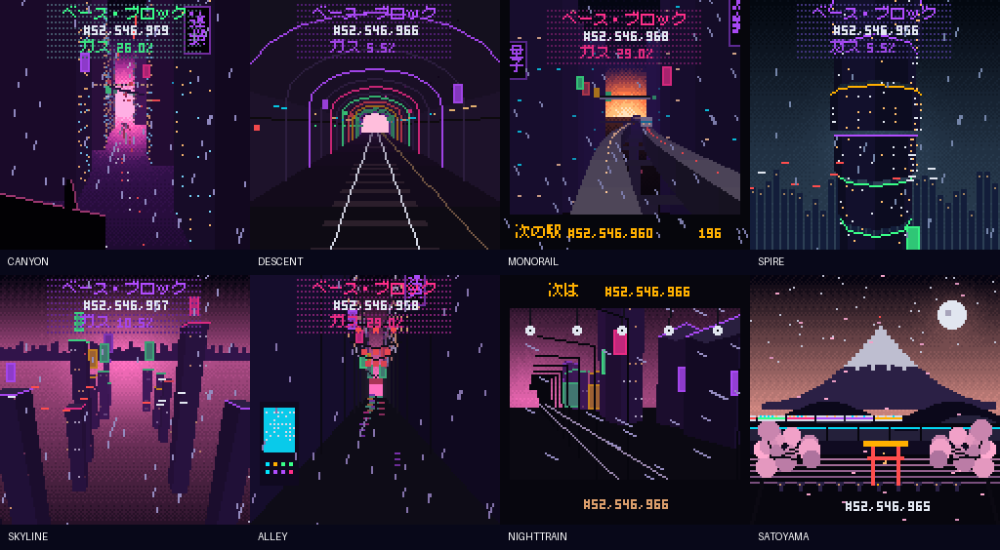

# Neo-Tokyo block art (development)

This is a separate collection under `src/blockart/`, preserving ghoulballs and its
live mint pages. Its collection name and symbol are both **blocks**. Nothing in
this branch is deployed or enabled for public minting.

One free mint claims one recent **ten-block Base epoch**. Token ID `e` represents
blocks `10e` through `10e+9`, and can be claimed only once. The ten supplied RLP
headers must link through their parent hashes and the newest must match the EVM's
`blockhash`. All ten blocks must be complete; the last must still be within the
256-block historical window. This is first come, first served per epoch, without
a per-wallet restriction or a fixed lifetime collection cap.

The contract stores a 3,520-byte record in a dedicated data contract: each block's
number, gas used/limit, timestamp, hash, state root and bloom. Artwork remains
renderable after the blockhash window expires. Transaction count is deliberately
absent: it is not an authenticated header field. Traffic/activity uses bounded gas
usage instead. The onchain recipe is an integer, 128px translation of the canvas
concepts, rather than a pixel-identical port of their gradients and fonts.

Each token returns a **128×128, 90-frame, six-second GIF** in its metadata image,
inside a pixel-sharp SVG wrapper. GIF timing uses repeating 7/7/6-centisecond delays
(an exact six-second loop; individual frames have quantised timing). A native
256-colour **AVI at 15fps** is exposed separately, generated from the same raster
frames with no offchain transcoding. It is not yet an `animation_url` player.

The last block hash selects CANYON, DESCENT, MONORAIL, SPIRE, SKYLINE, ALLEY or
NIGHT TRAIN from its first four bytes modulo seven. If the fifth byte is below
four, rare SATOYAMA takes precedence (approximately 1/64 under uniform hashes).
These choices are deterministic and publicly observable before minting.

Each scene is a separate immutable contract; the router fixes all eight addresses.
Shared components provide raster primitives, glyphs, camera projection, palette
ramps and word-parallel GIF/base64 writers. The frame loop reuses one encoded
backdrop/preparation buffer and makes a frame-local STATICCALL for each paint.
This keeps drawing code in one entry point and releases temporary memory between
frames; the complete GIF/AVI/metadata still comes from one top-level static call. Large binary results are returned and
forwarded in place to keep quadratic EVM memory costs under control.

## Measured Base/Cancun examples

Compiler Solidity 0.8.37, optimizer 200 runs, via IR, Cancun. Each media or metadata
row is an actual static call capped at 500M, including ABI return copying, excluding
subsequent caller-side decoding and file export. Epoch 5254696 is the recorded
Base example; dense input is a test-only full bloom/hash/state/full-gas fixture,
not an authenticated Base epoch or a worst-case proof over all possible headers.

| Scene | GIF gas | AVI gas | Full metadata gas | Dense metadata gas | Runtime bytes |
| --- | ---: | ---: | ---: | ---: | ---: |
| CANYON | 245,202,528 | 200,521,710 | 407,625,252 | 450,579,948 | 20,774 |
| DESCENT | 195,487,116 | 150,781,331 | 357,909,840 | 356,448,833 | 17,578 |
| MONORAIL | 298,052,538 | 253,374,459 | 460,475,262 | 477,196,010 | 22,026 |
| SPIRE | 230,478,851 | 185,802,036 | 392,901,575 | 398,802,381 | 15,761 |
| SKYLINE | 268,278,947 | 223,596,325 | 430,701,671 | 481,251,495 | 18,895 |
| ALLEY | 184,134,746 | 139,451,781 | 346,557,470 | 360,587,090 | 20,353 |
| NIGHTTRAIN | 234,003,645 | 189,302,194 | 396,426,369 | 425,300,804 | 21,273 |
| SATOYAMA | 82,858,100 | 38,184,202 | 245,280,824 | 241,493,574 | 16,612 |

Every GIF is **1,675,161 bytes**, AVI **1,477,976 bytes**, and sample metadata
approximately **2.98MB**. The default/Amsterdam and Cancun exports are byte-identical
for all eight GIFs, AVIs, raw rasters, palettes and metadata responses. Profile
reports are [Cancun](../previews/blockart/validation-blocks_base.json) and
[Amsterdam](../previews/blockart/validation-default.json).



The [local preview gallery](../previews/blockart/index.html) provides original
GIF and AVI downloads. The images are exact Solidity output; the contact sheet is
an offchain montage.

## Reproduction

Use the pinned toolchains: Foundry >=1.8.5, Solidity 0.8.37/Cancun (`blocks_base`) for this new collection, and
Solidity 0.8.37/Amsterdam for the default profile. Tests use recorded Base headers
and local blockhash mocks; they send no transactions.

```bash
FOUNDRY_PROFILE=blocks_base forge test --offline --match-path 'test/blockart/*' -vv
python3 scripts/validate_blockart.py --profile blocks_base
# Human review of the actual Solidity output:
python3 -m http.server 4173 --directory previews/blockart
# Open http://localhost:4173/
```

Legacy `base`/`base_sepolia` profiles retain Solidity 0.8.30 for existing deployments.
The new collection has its own compiler profile; compiling with it does not change
the execution fork used for Base.

The scene tests export raw raster frames, GIFs, AVIs, full metadata and individual
capped-call measurements. Validation strictly decodes the metadata layers,
compares every frame with Pillow and FFmpeg, checks the six-second timing, and
produces a contact sheet. Foundry checks frame 90 equals frame zero, the contract
size limit, epoch uniqueness/window rules, receiver rejection/reentry, transfers
and persistent stored data. Raw frames are the codec reference; there is no claim
of independent validation of all scene geometry against the canvas prototypes.

The large raw frames and per-scene URI files are reproducible fixtures. Preview
GIF/AVI media are the exact return bytes. A contact sheet or enlarged gallery is
an offchain presentation of those outputs.

## Remaining release gates

Review the translated artwork, check the profile measurements and dense synthetic block inputs, and probe the actual new metadata
on marketplaces. Earlier ghoulballs playback evidence covers its deployed build;
it does not establish retrieval of these approximately 3MB metadata responses.
Deploying, verifying and publishing this separate collection requires its own
release authorization. The existing ghoulballs signing approval is unrelated.

## Glyph attribution

Japanese glyphs derive from **Misaki Gothic 2nd**, by Num Kadoma. See the
[font page](https://littlelimit.net/misaki.htm) and its linked licence. The checked-in
glyph generator accepts the upstream PNG atlas and extracts the small used set;
it is not a system-font dependency of the onchain renderer.

## Deployment preparation and page

`script/DeployBlockArt.s.sol` contains strict Base and Base Sepolia entry points.
It validates the recent proof before broadcasting any deployment transactions,
then deploys eight scenes, the router and collection, followed by the first mint
to the deployer. No broadcast has been authorized for this collection.

`scripts/blockart_proof.py EPOCH` reconstructs public RLP headers and checks their
hashes and parent links. Its JSON is supplied as `BLOCKART_HEADERS_JSON`, with
`BLOCKART_EPOCH` as the epoch number. A dry-run (without `--broadcast`) uses:

```bash
FOUNDRY_PROFILE=blocks_base forge script script/DeployBlockArt.s.sol:DeployBlockArtBase \
  --rpc-url "$BASE_RPC_URL"
```

The proof must remain recent through deployment. Real deployment costs, receipts,
source verification inputs and marketplace playback still need to be recorded
before release. `deployments/blocks-base.json` records development status only.

The separate `/blocks/` page reconstructs the ten headers, checks the blockhash
window, ABI-encodes the proof and estimates the free mint before asking the wallet
to sign. The original ghoulballs page and wallet source are preserved. The new
page is deliberately disabled: `scripts/sync_blocks_config.py` only enables it
from its own confirmed eleven successful transactions (ten deployments and the
first mint), runtime checks and OpenSea evidence for the actual new collection.
Mocked-wallet tests verify zero-value submission and no send after proof expiry,
a wallet change, estimation failure or a closed release.

The local browser check is `node scripts/blockart_browser_qa.mjs`. Its committed
screenshots are mocked QA: they exercise a closed release, proof submission,
receipt matching, eight real preview GIFs and mobile layout in Chromium. No real
transaction is sent. Firefox and Safari checks are still outstanding.

### Ethereum Sepolia deployment

Ethereum Sepolia is chain **11155111**, using the default Solidity 0.8.37 / Amsterdam
profile. It is separate from Base Sepolia (84532). Its proof uses Ethereum Sepolia's
own ten consecutive blocks. The proof encoder includes `blockAccessListHash` and
`slotNumber` for Amsterdam headers, while preserving Base header hashes.

Configure `SEPOLIA_RPC_URL`, `DEPLOYER_PRIVATE_KEY` and its matching
`DEPLOYER_ADDRESS` in the gitignored local `.env`. Rehearse with
`python3 scripts/deploy_blocks_sepolia.py --env-file /path/to/.env`.
After deployment authorization, add `--broadcast`. The script checks chain ID,
header hashes, parent links, signer address and funding; fetches a fresh epoch;
and deploys eight scenes, the router and collection before minting that epoch to
the deployer. It caps testnet fees explicitly and never passes the private key as
a command-line argument. A rehearsal does not authorize a broadcast.

Record confirmed receipts in `deployments/blocks-sepolia.json`, separately from
Base. The existing `/blocks/` production mint route remains gated for Base; a
Sepolia deployment does not enable that route or replace the ghoulballs collection.

The Ethereum Sepolia collection is deployed at
[`0xedff9b1dfb79ba12fde25fc8c1aadb730a3b5825`](https://sepolia.etherscan.io/address/0xedff9b1dfb79ba12fde25fc8c1aadb730a3b5825).
The first token, **1194011**, is ALLEY, derived from Sepolia blocks
11,940,110–11,940,119 and minted to the deployer. All eleven transactions succeeded,
using **264,264,442 gas** and paying **4,757,410,377 wei** in total. The live tokenURI
and AVI each succeeded with a 500M-gas call cap. Pillow and FFmpeg confirmed all
90 frames, six-second timing, and exact GIF/AVI RGB agreement. Confirmed addresses,
receipts, code hashes and media checks are in `deployments/blocks-sepolia.json`;
source-verification inputs are in `verification/blocks-sepolia/`. This testnet
deployment does not establish marketplace playback or launch the Base mint route.

All ten deployed contracts have **exact creation and runtime matches on Sourcify**.
The NFT source is available at
[Sourcify](https://repo.sourcify.dev/11155111/0xedff9b1dfb79ba12fde25fc8c1aadb730a3b5825).
Foundry's `--verify` also attempted Etherscan; its verifier currently rejects the
Amsterdam EVM target (and initially had indexing errors for two scenes). This
explorer limitation did not affect deployment or the successful Sourcify checks.

### Single-block revision (`BLOCKS_SINGLE_V1`)

The requested replacement uses **one NFT per execution block**, selected by
`mint()` without arguments. `SingleBlockNFT` captures that block's number,
timestamp, gas limit, base fee, prevrandao, beneficiary and chain ID. There are no
supplied headers, no previous-block hash, no caller seed and no epoch lookup.
The current block's final hash, state root, gas used and bloom are not exposed by
the EVM; this recipe does not claim to capture them.

The exact single-block record is stored immutably in a STOP-prefixed data contract.
Its seed feeds ten **visual channels** in the existing immutable eight-scene
renderer. These are generated drawing parameters, not ten historical blocks or
fabricated block measurements. Every displayed block number is the actual mint
block, and public traits expose real captured fields. The new recipe name keeps
this data model separate from `NEO_TOKYO_BLOCKS_V1`.

`seedOf`, `blockData`, `sceneOf`, `gif`, `avi`, `tokenURI` and `latestTokenId` expose
the result. The first successful mint per block wins; a receiver callback cannot
mint it again. Transfers and future blocks do not change the stored data.

All eight scenes pass capped metadata/GIF/AVI checks and independent decoding of
720 RGB frames with the new data model. Measurements are in
`previews/blocks-single/validation.json`; run `scripts/validate_single_block.py`
after the Foundry tests to reproduce them. Metadata costs in the measured set
range from 234,255,355 to 448,416,431 gas.

The revised collection was explicitly authorized and deployed on Ethereum Sepolia
on 2026-10-18: **0x4a37f71418870d89e192bc973626db8eb4ded06b**, reusing the verified
scene router. Its first NFT is **DESCENT #11941801**, minted to the deployer.
The two successful transactions used **15,716,455 gas**, costing **267,179,735 wei**
in total test ETH. The first token's captured fields match the actual mint block;
its 90 GIF and AVI frames decode identically, last six seconds, and loop.
Sourcify confirms exact creation and runtime source matches. Etherscan's direct
standard-JSON check still rejects the Amsterdam EVM target.

`deployments/blocks-single-sepolia.json` records the receipts and validation.
The separate immersive site at https://blocks-eight-pi.vercel.app uses this
collection and its zero-argument mint. The original epoch deployment and the
Base `/blocks/` release configuration remain separate. The deployment script
refuses a duplicate broadcast once this manifest is deployed.
